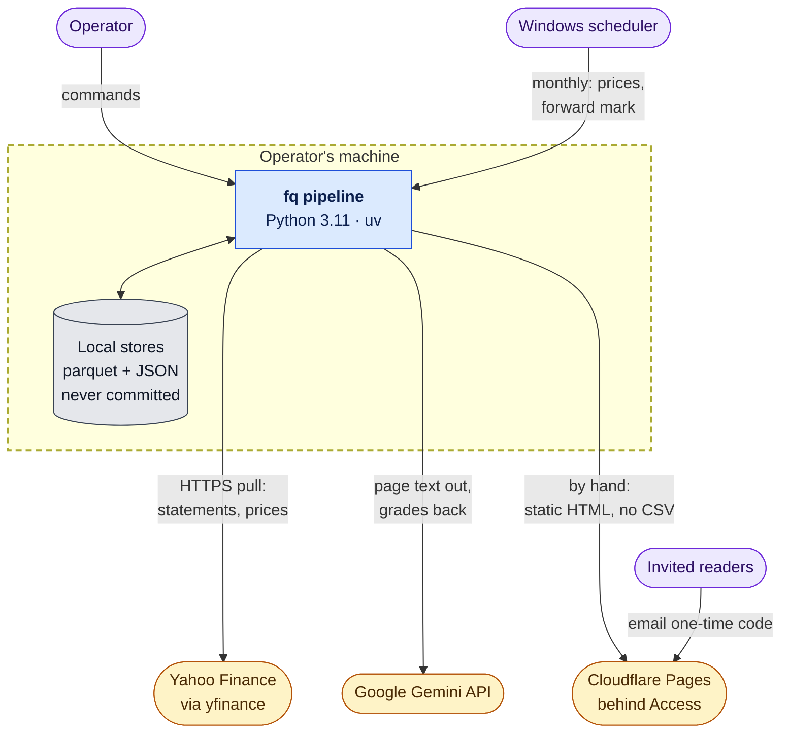
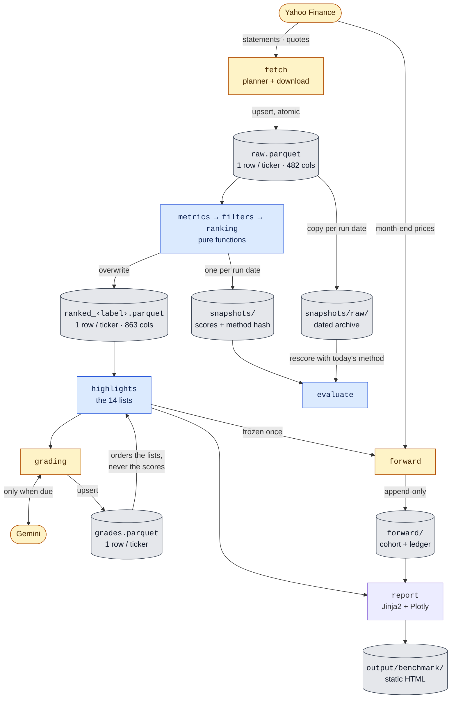
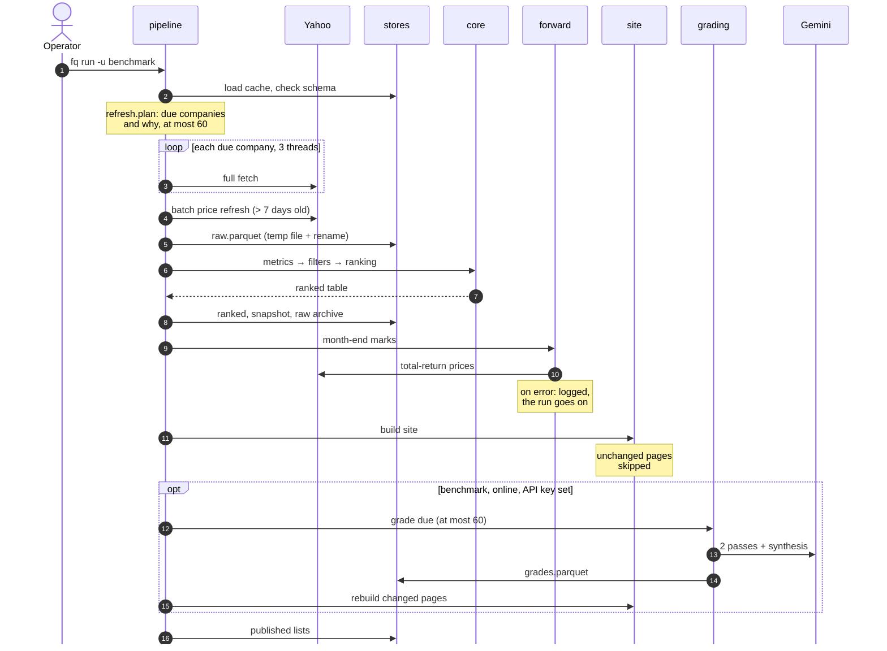
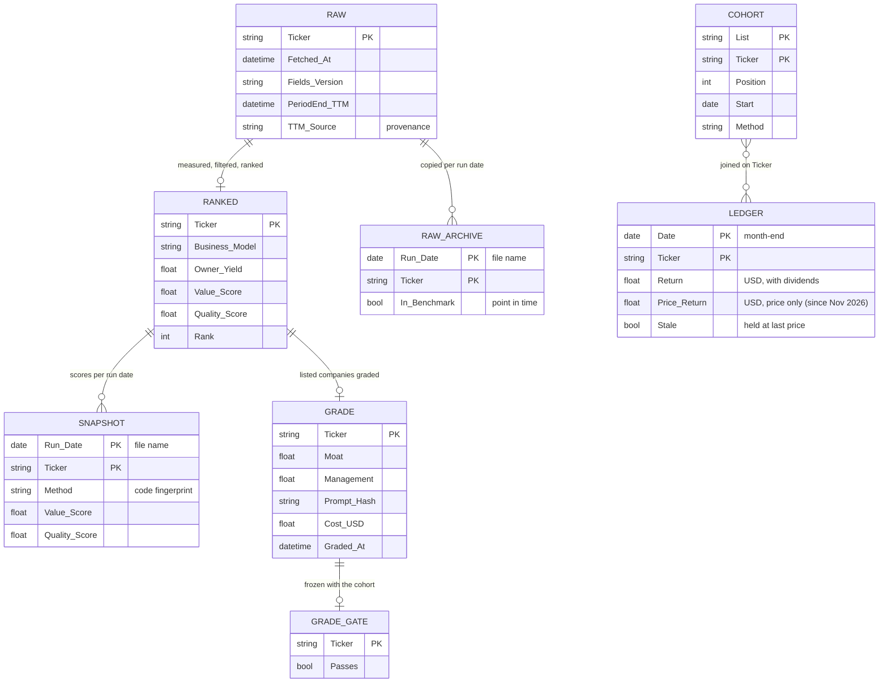
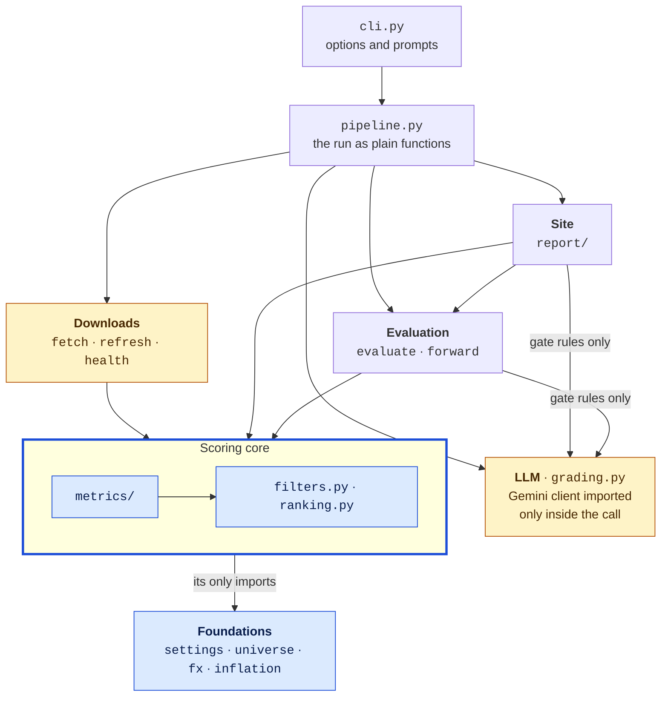

# Architecture

A batch data pipeline that turns about 9,900 companies' raw financial statements into comparable scores, a static
website and a self-checking forward test. It runs on one machine. This document covers the design and the
reasons for it. The docstrings are the source of truth for each function.

## Contents

- [Summary](#summary)
- [System context](#system-context)
- [Data flow](#data-flow)
- [One run, step by step](#one-run-step-by-step)
- [Data model](#data-model)
- [Layers](#layers)
- [The LLM boundary](#the-llm-boundary)
- [Quality attributes](#quality-attributes)
- [Trade-offs](#trade-offs)
- [Failure modes](#failure-modes)
- [Operations and testing](#operations-and-testing)
- [How the project is developed](#how-the-project-is-developed)

## Summary

Three ideas shape the design:

1. **The scores are deterministic and auditable; AI stays at the edge.** Every score is arithmetic on reported
   figures. An LLM grade only reorders what the lists show, and a test makes it impossible for the scoring code to
   import the LLM.
2. **The pipeline is incremental and fault tolerant.** A planner fetches each company only when something changed,
   within a per-run budget. Writes are atomic, and an optional stage that fails never blocks the site.
3. **Evaluation is honest by construction.** Each run's scores are tagged with a hash of the scoring code, and a
   frozen, append-only forward test measures the lists against the market in real time.

| Scale (Nov 2026) | |
|---|---|
| Benchmark | 9,902 tickers from 52 index and market lists, 69 countries |
| Raw cache | 9,938 companies × 482 columns (32 MB parquet) |
| Ranked table | 9,670 companies × 863 columns; 9,485 ranked |
| Code | ~10,000 lines of Python, 378 offline tests |
| LLM spend so far | $42.80 for 391 graded companies |

## System context

**Everything runs on the operator's machine, which is the trust boundary (dashed). Only three things leave it:** requests to Yahoo, company pages sent
to Gemini, and the static site uploaded to Cloudflare.

- No secret is stored in the repo: `GEMINI_API_KEY` comes from the environment.
- Private inputs (`portfolio.txt`) and every store (`data/`, `output/`, `logs/`) are gitignored.
- The bulk CSV is built locally but never deployed. Yahoo's text is untrusted, so Jinja2 autoescape stays on.

[Back to contents](#contents)

## Data flow

**Data moves one way, from source to published page.** Each store is labelled with its format, grain and write
pattern.

Blue boxes are pure functions with no I/O, amber boxes reach outside the machine, grey cylinders are stored
data, and the site builder (uncoloured) only writes local files. The metric core is a fixed sequence of steps, each writing named columns that later steps read
(`uv run python -m fq.columns` generates the column catalogue):

| Step | What it does |
|---|---|
| `cleaning` | blanks unit errors and unconfirmed TTM anomalies (audited annual figures are only noted, never blanked) |
| `capital` | leases, enterprise value, book value, the shareholders' base |
| `flows` | owner earnings (cash profit after the investment that keeps the business as it is), ROIC, acquisitions, dividends |
| `inflation` | drops unrestated years in high-inflation reporters |
| `normalise` | normal-year earnings power, growth profiles |
| `quality` | ROIC level, trend and stability; leverage; per-share growth; share reduction |
| `valuation` | the Value inputs (owner yield on a normal year) |
| `flags` | suspect-data and model-review flags that keep a company off every list |

Each company is scored as a percentile within its peer group (operating, asset-heavy, bank, insurer) across the
whole benchmark, so its score doesn't depend on which run it is in. Each criterion is a named entry in
`settings.py`, and its input is computed in the matching `metrics/` step.

[Back to contents](#contents)

## One run, step by step

**A run does only the work that is due, and every optional stage can fail without losing the site.** This is
`fq run -u benchmark`, as implemented in `pipeline.py`:

**When a company is re-fetched** (`refresh.reason`; otherwise it only gets a price refresh):

| Reason, in priority order | Trigger |
|---|---|
| new | not in the cache (the run's own new tickers bypass the budget) |
| earnings passed | an earnings date passed since the last fetch, plus 2 days |
| quarter due | last quarter end + 3 months + 45 days |
| annual due | last fiscal year end + 1 year + 90 days |
| new fields | the fetched field set changed since (`FIELDS_VERSION`) |
| incomplete | TTM or a critical line missing, retried after 7 days |
| old | older than 90 days |

Download and ranking can also run apart: `fq fetch --max-fetch 0` as often as needed, then `fq run --offline`.
Every command and option: `uv run fq --help`.

[Back to contents](#contents)

## Data model

**Eight datasets. Two of them can't be rebuilt and are protected:** the grades, which cost money, and the forward
test, which can't be re-run once Yahoo forgets a delisted company.

| Dataset | Path | Rows today | Written | Kept |
|---|---|---|---|---|
| RAW | `data/raw.parquet` | 9,938 | upsert per fetch, atomic | rebuilt only when `SCHEMA_VERSION` changes |
| RANKED | `data/ranked_<label>.parquet` | 9,670 | overwritten every rank | derived, rebuildable |
| RAW_ARCHIVE | `data/snapshots/raw/<date>.parquet` | 12 days | one per run day | kept, so old dates can be rescored |
| SNAPSHOT | `data/snapshots/<label>_<date>.parquet` | 21 runs | one per day; a same-day run replaces it | kept |
| GRADE | `data/grades.parquet` | 391 | upsert when due, saved per company | kept: costly to rebuild |
| GRADE_GATE, COHORT | `data/forward/` | 387, 381 | frozen once | **never deleted** |
| LEDGER | `data/forward/ledger.parquet` | 2,118 | appended each month-end | **never deleted** |

Periods are relative (`TTM`, `Y0` = latest annual report, `Y1`, ...); real dates live in `PeriodEnd_<period>`. No
calendar year appears in code or column names.

[Back to contents](#contents)

## Layers

**The scoring core imports only the foundations, and a test enforces it.** An arrow means "imports".

`tests/test_layers.py` parses every import, lazy ones included, and fails if any of these rules breaks:

- The scoring core (`metrics/`, `ranking.py`, `filters.py`, `settings.py`) never imports the site, the downloads,
  the LLM, the pipeline or the evaluation.
- The site never imports the command line, the pipeline, the downloads or `evaluate.py`.
- Only the entry points (`cli.py`, `pipeline.py`) import the pipeline or the command line.
- `grading.py` reads nothing from the site except the slug function that names its files.

The site and the evaluation read the grade's gate rules (constants and pure functions) from `grading.py`. The
Gemini SDK is imported only inside the one function that calls it.

[Back to contents](#contents)

## The LLM boundary

**The model judges; it never scores.**

| Aspect | Design |
|---|---|
| Input | The company's own page as markdown, stripped of every conclusion the system draws (scores, ranks, badges), so nothing anchors the grade |
| Process | Two independent grading passes (`gemini-4-argon`) averaged, then a synthesis by a cheaper model (`gemini-3.8-flash`) |
| Output | Moat and Management, 1 to 5. A gate keeps a company at the top of its list or moves it to the bottom. Scores and ranks are untouched |
| Caching | One row per company, keyed on `Prompt_Hash` (prompt, models, passes, page format). Redone only when that hash, the latest annual report or the one-year age limit says so |
| Cost control | At most 60 grades per run, a `--dry-run` estimate before spending, tokens and `Cost_USD` stored per company; rewording the synthesis never re-runs the costly passes |

[Back to contents](#contents)

## Quality attributes

| Attribute | How it is achieved | Where |
|---|---|---|
| Reproducibility | Deterministic core; each snapshot carries a hash of the scoring code; dated raw archives let any past date be rescored with today's method | `evaluate.method_fingerprint`, `pipeline.rescore` |
| Reliability | Atomic parquet writes; schema check on load; the forward test and grading are isolated, so their failure never blocks the site | `fetch.save_raw`, `health.check_schema`, `pipeline.forward_step` |
| Data quality | Unit-error and anomaly checks, provenance per company, suspect companies kept off every list | `metrics/cleaning.py`, `ranking.trusted` |
| Cost | Incremental fetching; grades cached on a hash with a per-run cap | `refresh.select`, `grading.due` |
| Performance | Unchanged company pages skipped by fingerprint; capped render processes for an 8 GB machine; the full ranking's rows load lazily | `company_page.PAGE_INPUTS`, `FQ_RENDER_WORKERS` |
| Security and privacy | Autoescape on untrusted text, secrets from the environment, private stores gitignored, site behind access control | `report/html.py`, `.gitignore` |
| Maintainability | Import layers tested; one registry of lists; ticker lists and overrides as text; a generated column catalogue | `tests/test_layers.py`, `report/highlights.TABS`, `fq.columns` |

[Back to contents](#contents)

## Trade-offs

| Choice | Instead of | Why | Revisit when |
|---|---|---|---|
| Parquet files | A database | One writer, batch access, wide columnar tables, nothing to operate | Several writers or concurrent readers |
| Static site | A web app | No server to secure, free hosting, cacheable pages | Readers need their own queries |
| Batch runs | Streaming | Fundamentals change quarterly, and the scores look years ahead, so weekly prices are enough | Never, for this purpose |
| LLM at the edge | LLM inside the scores | Scores must be reproducible, cheap and explainable line by line | Never for scores |
| One machine | Cloud jobs | The stores total under 100 MB of parquet; the 8 GB memory limit is handled by capping render workers | The universe grows tenfold |
| Criteria chosen by reasoning | Weights fitted to past returns | Fitting to price history overfits; the forward test judges the result instead | — |

[Back to contents](#contents)

## Failure modes

| What fails | How it is detected | What happens |
|---|---|---|
| Yahoo renames or drops a row | Coverage warning in `health.py` | Aliases and composites rebuild it; a new alias fixes the rest |
| Rate limiting | Fetch errors | Threads take turns; the budget defers the rest to the next run |
| Cache from an older schema | `SCHEMA_VERSION` check | `fetch` discards it; `rank` refuses it |
| Run killed mid-write | — | Temp file plus rename: the previous file stays whole |
| Gemini error or no API key | Exception or missing key | Grading skipped and logged; the site builds with the grades it has |
| Forward test error | Exception | Logged; the report is still built |
| Month-end download gap | More than 20% of tickers unpriced | The month is not stored, and is retried next run |
| A company is delisted | No price after a mark | Held at its last value and marked `Stale` |

[Back to contents](#contents)

## Operations and testing

- **Environment:** `uv` with a locked `uv.lock` (yfinance pinned); lint and format with Ruff.
- **Tests:** 378 tests on synthetic data, with no network. They cover method rules, extraction edge cases taken
  from real failures, the layer rules, agreement between the front page and company pages, and forward-test
  accounting.
- **Schedule:** a monthly job refreshes prices and adds the month-end to the forward test. Deploying is always by
  hand.

[Back to contents](#contents)

## How the project is developed

**Built with an AI coding agent inside explicit guard-rails:**

- A short instructions file (`CLAUDE.md`, kept out of this repository) is the map the agent loads every
  session: layout, rules (for example "LLM only in `grading.py`", "never delete `data/forward/`") and recipes for
  adding a list, a criterion or a metric step.
- Private decision records give each choice its date and reason, so a later change can be judged against why
  the current one was made.
- The rules that matter most are tests, not conventions: import layers, the LLM boundary, front-page and
  company-page agreement.
- A backlog holds known, parked work, so scope stays deliberate.

[Back to contents](#contents)
