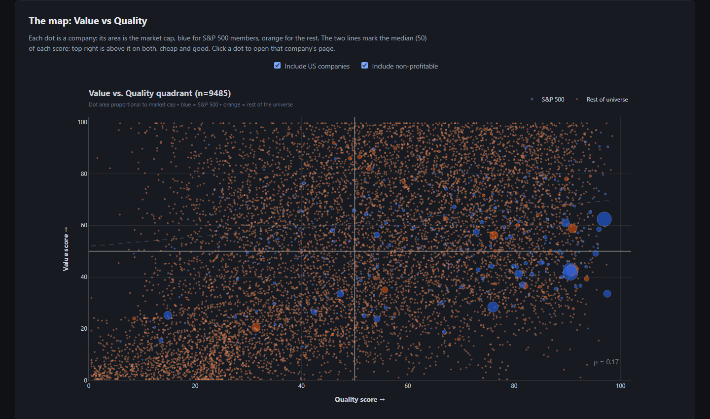
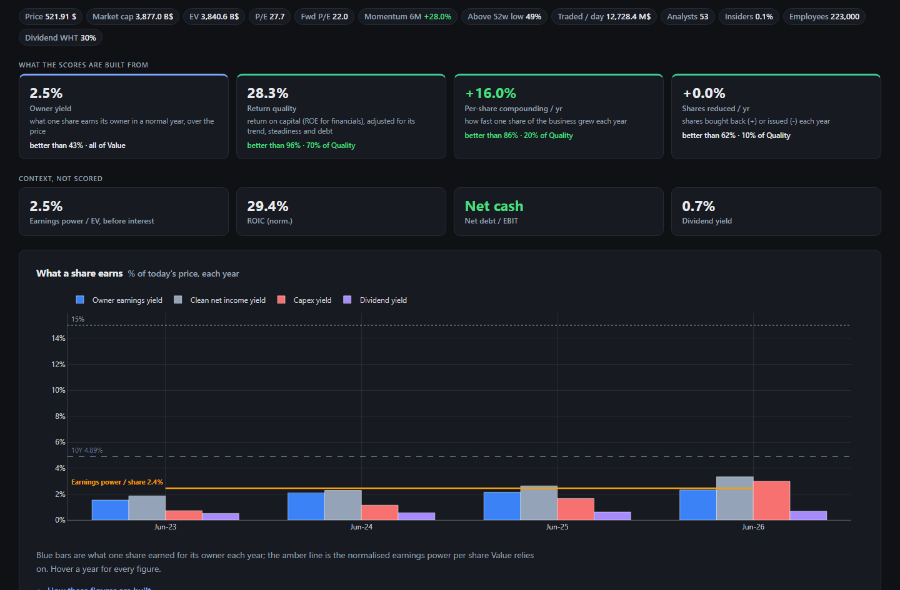
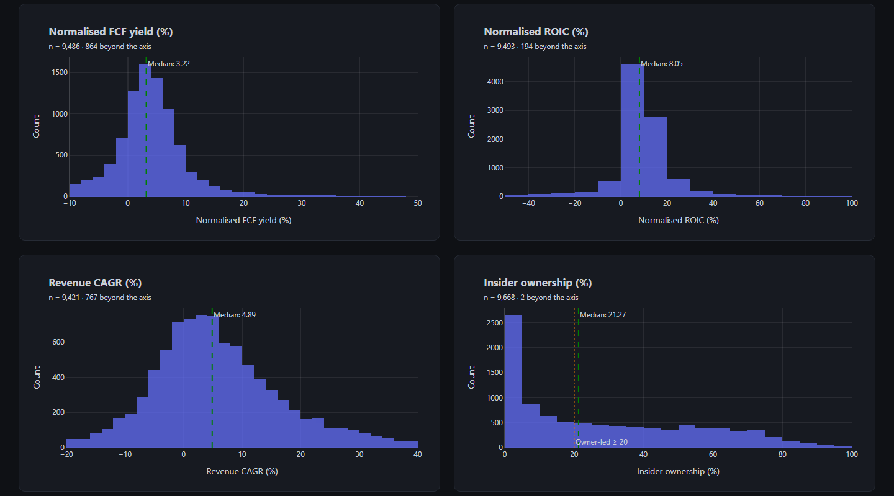
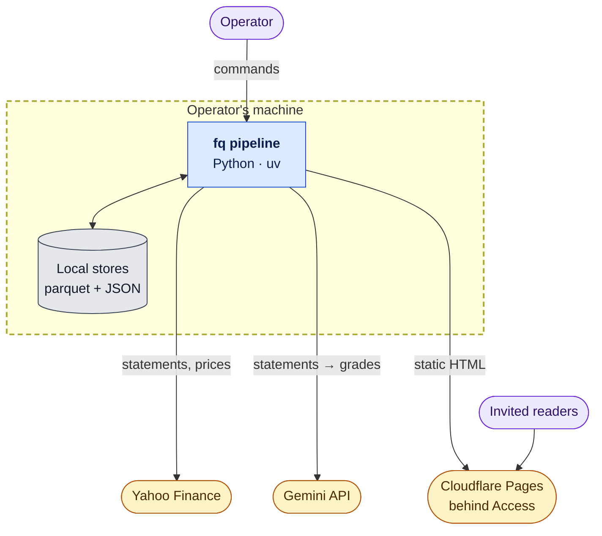

# Turning over the Rocks: a global equity screening pipeline

A batch pipeline that ranks 10k+ listed companies in about 70 countries on value and
quality. It applies the same written rules to every company and notes the figures it had to repair.

> **Not financial advice.** The rankings are a starting point for reading a company's reports, not a
> recommendation to buy or sell. See [Data source and terms](#data-source-and-terms).

**[Read the architecture →](ARCHITECTURE.md)**

## Contents

- [What it does](#what-it-does)
- [Key figures](#key-figures)
- [Architecture at a glance](#architecture-at-a-glance)
- [System highlights](#system-highlights)
- [Quickstart](#quickstart)
- [Repository map](#repository-map)
- [Data source and terms](#data-source-and-terms)
- [License](#license)

## What it does

Each company gets two scores:

- **Value:** what one share earns for its owner today in a normal year, no growth assumed (*owner earnings*:
  cash profit after the investment needed to keep the business as it is), before interest, against the price of
  the business (market cap plus debt, less spare cash), so debt and cash do not change the rank. Each company
  page leads with the same earnings after interest, over the share price.
- **Quality:** how much the business earns on the capital it uses, how steadily, and whether each share keeps
  growing.

Both are plain arithmetic, with no model inside. Profitable operating companies are ranked against each other;
banks, insurers, holdings, REITs and utilities are scored against their own kind. Nineteen lists then pick out
companies worth a closer look, and an LLM grades those companies' moat and management. The grade only folds a
list's weaker members away; it never changes a score. A
frozen forward test tracks month by month whether the lists beat the market. The output is a static website
with one page per company.



<details>
<summary>More screenshots: a company page, the universe's distributions</summary>





</details>

## Key figures

| | |
|---|---|
| Companies scored | 10k+, from a benchmark of 11k+ tickers drawn from 50+ index and market lists; about 6,400 profitable operating companies ranked |
| Markets | about 70 countries; statements read in their reporting currency, returns compared in US terms |
| Data | about 480 raw columns per company and about 870 in the ranked table, in parquet |
| Code | about 12,000 lines of Python, plus about 490 offline tests |
| LLM cost | about $0.10 a graded company (two passes, one when the first fails); about 950 graded; checks of the numbers about $0.02 each, about 1,000 made; recorded per company |

## Architecture at a glance

Everything runs on one machine. Only three things cross its boundary: requests to Yahoo, company pages sent to
Gemini for grading, and the static site uploaded by hand.



The full design is in [ARCHITECTURE.md](ARCHITECTURE.md): the [data flow](ARCHITECTURE.md#data-flow),
[one run step by step](ARCHITECTURE.md#one-run-step-by-step), the [data model](ARCHITECTURE.md#data-model), the
[layers](ARCHITECTURE.md#layers), [trade-offs](ARCHITECTURE.md#trade-offs) and
[failure modes](ARCHITECTURE.md#failure-modes).

## System highlights

- **One boundary, three interfaces.** The operator's machine is the only trust boundary. Three interfaces cross
  it: statements and prices from Yahoo, page text to Gemini, and the static site to Cloudflare.
  [System context →](ARCHITECTURE.md#system-context)
- **A separate scoring core.** Scoring is a fixed sequence of functions that read the cache and local reference
  files and write nothing. It may not import the network, the site or the LLM, and a test checks those import
  rules. [Layers →](ARCHITECTURE.md#layers)
- **Repeatable results.** The same inputs give the same scores. Each run's scores carry a hash of the scoring
  code, and dated copies of the raw cache let any past date be rescored with the current method.
  [Quality attributes →](ARCHITECTURE.md#quality-attributes)
- **Bounded use of outside services.** A company is fetched only when a report is due or its data is old, within a
  per-run budget. Grades are cached on a prompt hash, capped per run and costed before they run.
  [One run →](ARCHITECTURE.md#one-run-step-by-step) · [LLM boundary →](ARCHITECTURE.md#the-llm-boundary)
- **Partial failure keeps the output.** Writes are atomic and the cache schema is checked on load. Grading and the
  forward test run apart from the rest, so if either fails, the site still builds.
  [Failure modes →](ARCHITECTURE.md#failure-modes)
- **Data checks at the input.** Unit errors and implausible twelve-month figures are tested, blanked or noted per
  company, and companies with doubtful data are kept off the lists. [Data flow →](ARCHITECTURE.md#data-flow)
- **Evaluation fixed in advance.** The forward test is frozen when it starts and only ever appended to.
  [Data model →](ARCHITECTURE.md#data-model)
- **Configuration as data.** Index lists, business-model overrides and exclusions are text files. Criteria and
  weights are named settings.
- **Built by one person with an AI coding agent,** under written rules, the key ones enforced by tests.
  [How it is developed →](ARCHITECTURE.md#how-the-project-is-developed)

## Quickstart

Requires Python 3.11+ and [uv](https://docs.astral.sh/uv/).

```
uv sync                                  # install
uv run fq run -u test --open             # 8 large caps: fetch, rank, build the site, open it
uv run fq run -u "AAPL,MSFT,SAP.DE"      # any Yahoo tickers
uv run fq run -u benchmark               # the full benchmark (hours on the first run)
uv run pytest                            # tests (no network)
```

The grade needs `GEMINI_API_KEY` in the environment and is skipped without it. Every command and option:
`uv run fq --help`.

## Repository map

| Path | What it holds |
|---|---|
| `src/fq/fetch.py`, `refresh.py`, `fx.py`, `health.py` | Download, refresh planning, exchange rates, cache checks |
| `src/fq/metrics/` | The measurement pipeline, one module per step |
| `src/fq/filters.py`, `ranking.py` | Scope filters; percentile scores and ranks |
| `src/fq/report/` | The site: list screens, charts, templates |
| `src/fq/grading.py`, `prompts/` | The LLM grade and its prompts |
| `src/fq/forward.py`, `evaluate.py` | Forward test; snapshot evaluation |
| `src/fq/pipeline.py`, `cli.py` | The run as plain functions; the command line |
| `src/fq/crawlers.py` | Auxiliary, opt-in Scrapy spider auditing public index constituent tables against `lists/` |
| `src/fq/lists/` | Index lists, business-model overrides, exclusions (text, not code) |
| `tests/` | Tests on synthetic data |
| `docs/img/` | The screenshots above |

## Data source and terms

- Market data is downloaded at run time through the open-source [`yfinance`](https://github.com/ranaroussi/yfinance)
  library. Neither that library nor this project is affiliated with or endorsed by Yahoo. Yahoo and Yahoo Finance
  are trademarks of their owner.
- **This repository contains no Yahoo data.** The cache, the site and the logs are excluded from git. Whoever runs
  the code downloads the data and is responsible for following Yahoo's terms of use.
- The site I build is for personal research and is shared privately behind access control. It is not a public data
  service, and the bulk CSV is never uploaded.
- The index lists are ticker symbols compiled from public sources, with no affiliation to the index providers.
- The grade is written by a third-party LLM (Google Gemini) from each company's description and statements, without its price.
- **Nothing here is investment advice.** Figures may contain errors from the source or from processing.

## License

Copyright (c) 2026 JAlvarezRomario. All rights reserved. Published for viewing only; see [LICENSE](LICENSE).
